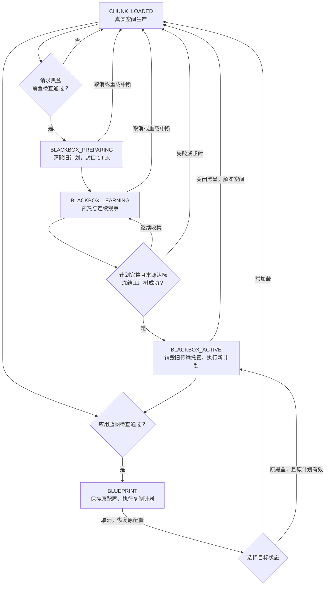
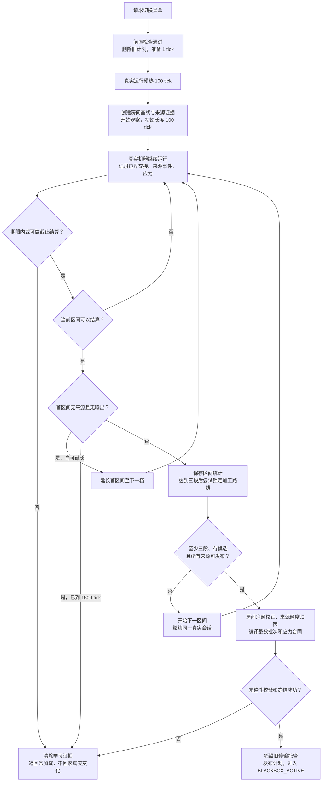
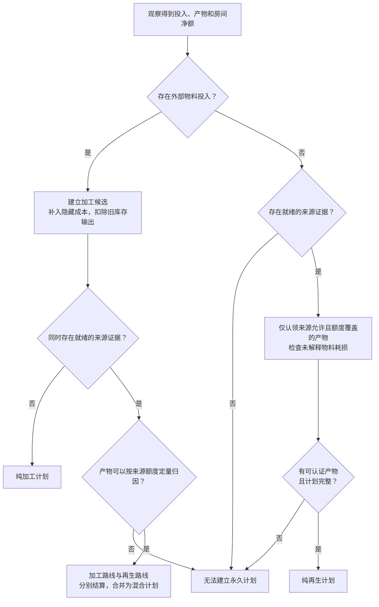
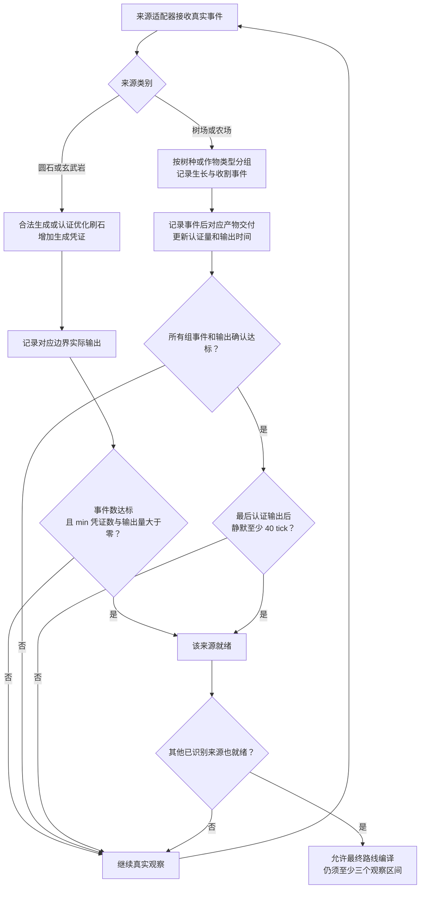
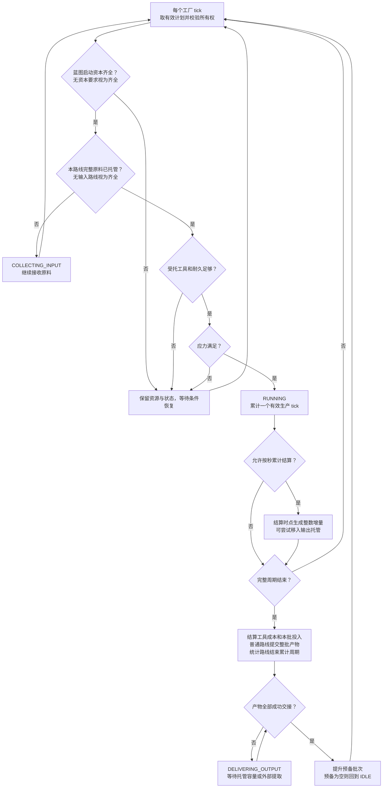
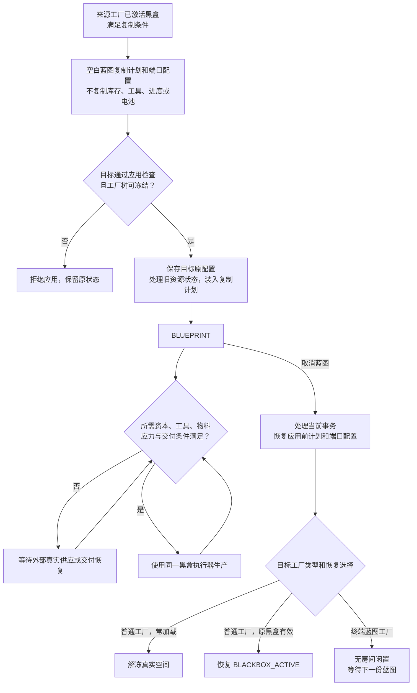

# v1.5.21 黑盒模式逻辑与流程图（历史快照）

整理日期：2026-10-13。依据：当前仓库提交 `5cf9e52`，模组版本 `1.5.21`，生产计划格式 `v9`。

本文保留 v1.5.21 的实现快照。v1.5.22 已调整来源参与、默认学习期限（3600 tick）和发布前完整账本校验，旧文中的 6000 tick 与提前锁定加工候选计划不再代表当前实现；当前规则见 [README](../README.md) 和 [v1.5.22 更新日志](releases/v1.5.22.md)。

本文按当前 Java 实现总结。流程图使用 Mermaid，可在支持 Mermaid 的 Markdown 查看器中渲染。文中的示例数量仅用于解释，并非预设配方。

## 1. 先区分三类“模式”

当前黑盒逻辑可以分为三个层次：

| 层次 | 分类 | 决定什么 |
|---|---|---|
| 工厂运行状态 | 常加载、准备、学习、黑盒激活、蓝图 | 真实房间是否运行，以及使用真实机器还是生产计划 |
| 生产路线 | 加工、再生、混合 | 产物由哪些投入或来源证据支持 |
| 执行方式 | 完整批次、按秒累计结算、不同超频档位 | 何时交付产物，以及生产速度和应力需求 |

核心逻辑：**先观察真实工厂，把边界投入、边界产出、内部耗损和应力编译为生产合同；激活后冻结真实房间，由工厂方块执行合同。蓝图复用同一个执行器。**

这里的“模拟运行”是本模组的计划执行逻辑；可选的 Simulated/Sable 兼容包负责移动结构，不是另一套黑盒学习模式。

## 2. 五种运行状态

| 状态 | 真实 Pocket 房间 | 物流和生产逻辑 | 如何离开 |
|---|---|---|---|
| `CHUNK_LOADED` 常加载 | 房间持有区块票，真实机器运行 | 实际资源跨边界交接；界面显示实际吞吐 | 请求黑盒并通过检查，或应用蓝图 |
| `BLACKBOX_PREPARING` 黑盒准备 | 尚未执行激活冻结 | 封闭旧输入代次，重建能力边界；持续 1 tick，不等待托管排空 | 进入学习；也可取消或失败回退 |
| `BLACKBOX_LEARNING` 黑盒学习 | 真实机器继续运行 | 先预热，再连续观察物料、来源、房间净额、工具和应力 | 成功激活；失败或取消返回常加载 |
| `BLACKBOX_ACTIVE` 黑盒激活 | 自身房间及后代空间冻结，释放 Pocket 区块票 | 根据本厂学习得到的计划模拟生产 | 手动关闭返回常加载，或应用蓝图 |
| `BLUEPRINT` 蓝图 | 目标原有空间被冻结；终端工厂没有房间 | 根据复制来的计划模拟生产，不再学习目标机器 | 取消后恢复原计划和端口配置，选择返回常加载或原黑盒 |

**祖先冻结是额外的停机标记，不是第六种运行状态。** 后代即使保存着 `CHUNK_LOADED` 或 `BLACKBOX_ACTIVE`，也会在祖先冻结时释放房间票并停止自己的 tick 生产。

### 2.1 状态转换图

图中只列主要操作路径。代码还会修复缺失计划、缺失蓝图和缺失冻结清单等存档异常。终端蓝图工厂取消蓝图后只是闲置，不会生成真实房间，也不能转为自主学习的黑盒。

### 2.2 开始学习之前检查什么

模式切换入口会检查房间是否处于扩缩或销毁等变更任务、嵌套身份是否有效，以及工厂树内是否存在玩家。终端蓝图工厂不能自行学习。

开始学习还会检查：

- 扩展传输参与者是否存在不能纳入学习的资源状态。
- 后代黑盒或蓝图是否包含无物料输入的再生路线；存在则拒绝父级学习，避免重复授予再生生产权。

检查失败时保留原状态。**通过后开始重学，会立即删除旧计划并处理旧运行事务；后续学习失败不会恢复旧计划。**

## 3. 所有工厂共用的学习流程

普通加工、刷石、树场、农场和混合工厂共用一个连续学习会话。没有为每类机器另设独立学习状态机。

### 3.1 时间和观察区间

1. **准备 1 tick**：封口并建立新边界代次。
2. **预热 100 tick**：真实工厂继续运行，尚未建立正式观察基线。
3. **建立基线**：读取房间物品、流体和工具耐久，创建来源证据集合，开始第一个观察区间。
4. **至少完成三个不重叠区间**：第一个区间从 100 tick 开始。没有已识别来源且没有输出时，延长为 200、400、800、1600 tick；第一次有效后，后续完整区间沿用该长度。
5. **尽早锁定加工路线**：至少三个区间后，如加工合同成立，锁定它；再生来源仍可继续收集证据。
6. **编译、校验和发布**：满足来源门槛、资源归因和计划完整性要求，并成功冻结工厂树后，才进入激活状态。

存在已识别再生来源时，允许前三个区间产出不足，继续观察。树木或作物等待不会使已经锁定的加工路线重新按更长等待时间计算效率。

统一期限 `blackboxMaxLearningTicks` 默认 6000 tick，**从请求切换时开始计算**，包含准备、预热、缺料、缺应力、输出堵塞和生长等待。在正常 20 TPS 下约为 5 分钟。达到期限时，来源已经就绪且已有足够观察的会话允许做最后一次结算；否则回退。

最大时长在准备阶段固定；来源验证次数在预热结束、创建来源证据对象时固定。配置修改不会改变已经创建的对象。

### 3.2 统一学习流程图

每个区间只结算本区间的边界统计，不重置真实机器。学习会话不保存到存档；服务器重启、区块实体重载、工厂移动等中断会结束本次学习。修改端口合同也会中止正在进行的学习。

### 3.3 物料如何记账

学习记录的是**资源所有权真正交接**：输入由房间内机器实际接收，输出由房间内机器实际交出。仅向外壳托管填入资源不等于完成生产投入。

物品组件、NBT 和流体组件参与完整资源身份；同注册 ID 但身份不同的资源分别统计。

房间账本以观察开始基线和当前状态比较，避免预装库存补贴配方：

| 观察到的现象 | 合同处理 |
|---|---|
| 输入类资源或隐藏资源在房间内净减少 | 补入加工成本 |
| 只从输出边界出现的资源净减少 | 视作历史库存交付，从观测输出扣除 |
| 来源凭证已经覆盖的再生产物库存减少 | 不再重复算作普通原料成本 |
| 房间库存净增加 | 不抵扣已经支付的边界输入，也不增发尚未交付的产物 |
| 没有外部输入，也没有合法来源，仅消耗预装库存 | 不能建立永久生产计划 |
| 无外部物料输入的再生工厂存在无法解释的物料耗损 | 拒绝编译 |

工具耐久单独计量并写入工具成本，不把耐久变化当作普通物品数量变化。

## 4. 不同生产路线的逻辑

### 4.1 加工路线

有真实外部物品或流体投入，生产对应产物。计划包含每批投入、每批产物、工具耐久、周期和应力。

运行时先托管完整原料，再在工具与应力满足时累计生产时间；完成后结算耐久、销毁本批投入并提交产物。缺料或缺应力时不生成产物。

例：外部提交铁锭，按学习到的周期和应力加工后交付铁板。实际数量比例来自学习结果。

### 4.2 再生路线

再生路线由合法来源证据和实际边界产出授予生产权。当前内建来源包括圆石、玄武岩、树场和农场。来源类型保存在 `SourceKind`，混合来源为 `COMPOSITE`。

“不消耗每批物料”仍需要满足计划规定的应力、工具耐久和输出交付条件。目标蓝图是否需要额外启动资本由来源合同决定；当前四种内建来源均不要求重新提交结构资源、树苗或种子。

### 4.3 混合路线

同一工厂有加工投入，也有可验证的再生来源。最终最多保留一条 `processing` 路线和一条 `regenerative` 路线：

- 已锁定加工路线保留原观察期间的效率。
- 再生路线使用来源持续观察期间认证的产量和时间。
- 各路线拥有自己的活动批次、预备批次和进度，共享工厂输入面、输出托管和应力满足条件。
- 同身份产物只有在来源额度能够定量解释时才能拆分；来源覆盖部分归再生，剩余可解释部分归加工。
- 外部输入与来源产物冲突、且无法确定归属时，拒绝发布。

### 4.4 来源内部加工的实际边界

来源证据只认领适配器允许的最终边界产物。**当前内建实现不能因为有刷石机，就自动推导“圆石进一步加工成任意最终产物”的无输入合同。** 如果最终产物不在来源允许范围内，且没有外部投入支持，不能直接建立该无输入路线。

例如，不能仅凭圆石生成事件认领全部碎石或铁粒产出。此类内部加工链需要相应适配器明确声明和认证产物关系。领域文档中的“来源耦合”概念不等于当前已经实现通用加工链推断。

### 4.5 路线归因图

## 5. 四种内建来源的差异

各来源验证次数默认 3，配置范围 3–5；验证次数是来源事件门槛，不是整个工厂重复重学的次数。

| 来源 | 候选和事件怎么建立 | 哪些产量可认证 | 发布条件 |
|---|---|---|---|
| 圆石 | 观察真实合法流体生成；或 Create 已验证的固定钻头优化刷石成功事件 | 圆石；认证量不超过生成凭证数和对应边界输出量的较小值 | 事件数达标且有认证产物 |
| 玄武岩 | 观察合法玄武岩生成拓扑；适配器也接收对应认证钻头路径 | 玄武岩；同样受生成凭证和实际输出双重限制 | 事件数达标且有认证产物 |
| 树场 | 初始扫描植物候选，按树苗种类分组；树木生长记录事件，同树种同 tick 的生长合并为一次 | 适配器允许的树木产物，按完整物品身份记录认证量 | 每个树种事件数达标，且最新事件后已有对应主要产物交付；再等待 40 tick 输出静默 |
| 农场 | 按作物方块注册 ID 分组；成熟收割、竖直作物新增一节、瓜果生成等记录事件 | 与已识别作物组匹配的产物 | 每个作物组事件数达标，且最新事件后已有对应产物交付；再等待 40 tick 输出静默 |

普通钻头完成一次破坏只说明钻头工作，不自动授予再生凭证。刷石来源不通过全房间扫描预存圆石建材建立证明，也不单凭高频端口输出认证。

树场和农场的所有已识别组都必须就绪。混合农场中一种作物长期不成熟，会阻止整份来源证据发布。40 tick 静默期用于等待在途产物交接；在绝对期限到达且证据已就绪时，控制器允许截止结算。

### 5.1 来源认证图

此图省略统一绝对期限和截止结算分支；它们由第 3 节的学习控制器统一管理。

## 6. 激活后如何运行

### 6.1 每条路线都是双批次流水线

一条路线最多托管一个活动批次和一个预备批次：

- 活动批次负责集料、等待工具和应力、累计进度、交付产物。
- 活动批次运行或交付期间，可以继续收取下一批原料到预备批次。
- 两批满后拒绝多余原料，由外部库存承担剩余缓存。
- 活动产物全部移入输出托管或被合法提取后，预备批次原子提升，后续 tick 继续生产。

当前运行阶段为 `IDLE`、`COLLECTING_INPUT`、`INPUT_COMPLETE_WAITING_FOR_POWER`、`RUNNING`、`DELIVERING_OUTPUT`。

### 6.2 普通结算与植物统计结算

| 执行方式 | 使用条件 | 何时生成可交付产物 |
|---|---|---|
| 完整批次 | 普通加工、确定性再生，以及带物料投入或工具耐久成本的统计路线 | 生产周期完成，并完成工具成本结算后，一次提交整批产物 |
| 按秒累计结算 | 路线带统计产出标记、属于再生路线，且没有物品/流体投入及工具耐久成本 | 每 20 个有效生产 tick 或周期末，交付累计应得量的整数增量 |

按秒结算使用 `floor(整周期产量 × 已完成进度 / 周期)`，再扣除已生成的累计数量。它按进度平滑交付已学习的统计产量；当前 `FactoryRuntime` 不按每批重新抽取植物随机掉落。

例：某无成本统计路线 100 tick 应产出 3 个物品，则在进度 20、40、60、80、100 时累计权益为 0、1、1、2、3，只新增差额，不能重复领取。

### 6.3 生产运行图

图中统计路线可在周期内交付产物；普通路线在周期末交付。两者都由唯一所有权账本结算。

### 6.4 输入输出面和背压

黑盒与蓝图提供共享输入需求和共享输出托管。任意有效 `INPUT` 面均提交到工厂级需求，当前调度器按稳定路线顺序分配共享原料；未看到按学习端口 ID 为同身份原料分流的运行检查。逻辑端口仍参与真实模式的连接与蓝图面配置。Create 包裹按整包需求校验，不能只提交包裹中的一部分。

任意 `OUTPUT` 面读取同一份工厂输出，增加输出面不会复制产物。共享托管容量按每条路线两个输出交接单位求和：普通路线以整批为单位，流式路线以一次统计结算的交接量为单位。能力可在同一 tick 被反复调用，容量用于形成背压，不是每 tick 的吞吐配额。

托管塞满后，已完成批次可能停留在交付阶段，从而阻止该路线开启下一活动批次。统计路线的已赚取产物保留在路线所有权中，周期结束仍需完成交接。不会无限追加生产批次。

## 7. 应力与超频

真实学习记录外部应力、内部发电、峰值消耗和应力时间，激活后按计划计算，不重新扫描被冻结的机器。

有可用内部供给时先抵扣生产负载，剩余部分由外部动力提供。多个外部 Create 网络同时连接时选择有效候选网络，不把互相独立网络的容量相加。应力不足就暂停累计有效生产时间，恢复后继续；不补算停机期间的产量。

| 烈焰电池数量 | 可选速度档位 |
|---|---|
| 0 | `1×` |
| 1 | `0.5×`、`2×` |
| 2 | `0.5×`、`2×`、`3×` |
| 3 | `0.5×`、`2×`、`3×`、`4×` |
| 4 | `0.5×`、`2×`、`3×`、`4×`、`5×` |

只有 `BLACKBOX_ACTIVE` 和 `BLUEPRINT` 使用超频。超频主要缩短或延长周期、调整负载；每批资源数量保持合同所有权约束。已学习内部发电容量不随超频增加，新增净需求由外部供给补足。

运行中切档会原子重定时各路线：按完成比例换算进度，保留活动投入、预备投入和已生成输出权益，不通过重启批次重复生成产物。树场、农场的已认证再生周期也允许超频。

## 8. 蓝图模式与终端工厂

### 8.1 蓝图复制什么

从可进入、有效且处于 `BLACKBOX_ACTIVE` 的来源工厂，使用空白蓝图复制：

- 生产计划、来源证明、周期、工具成本、资本合同和应力合同。
- 六面输入输出模式与逻辑端口 ID。
- 来源工厂名称、身份、位置、维度和层级等说明信息。

**蓝图不复制真实库存、受托工具、已支付资本、活动或预备批次、生产进度及烈焰电池。** 需要供应工具、资本或原料而没有输入面时，蓝图会尝试配置一个输入面。

应用蓝图会校验数据、目标和来源身份、已有蓝图、运行事务以及玩家/冻结条件。通过后保存目标原计划和端口配置，再进入 `BLUEPRINT`。目标原有电池保留，速度按目标的可用档位执行。

取消蓝图恢复原配置，不回滚真实物料和耐久。正常有房间工厂可返回常加载，或者在原计划有效时恢复黑盒执行。

### 8.2 蓝图流程图

### 8.3 终端蓝图工厂

最大有空间嵌套深度的下一层可放置终端蓝图工厂。它没有独立 Pocket 房间、不能进入、不能自行学习，只能应用蓝图生产。它仍参与父子关系和祖先冻结；取消蓝图后闲置，不回到真实机器运行。永久拆除时处理其真实资源，掉落无身份的原始工厂物品。

## 9. 速率、资源边界与失败行为

### 9.1 从统计速率到完整批次

加工路线按锁定前观察总数量除以总时间得到速率；来源路线按持续学习的认证产出和观察时间得到速率。观察中的零产出时间保留在分母中。

每项物品和流体分别做近整数贴合：与最近且至少为 1 的整数相差不超过 0.2 时可采用整数；代码同时要求总时长能按整秒结算并满足数值范围。否则保留实际有理数。再将数量和 tick 总时长按最大公约数约简为整数资源向量及整数周期。

因此界面可以显示小数 `/s`，实际交接仍然只有完整物品和整数流体量。例：0.3 个/s 可以表示为每 200 tick 交付 3 个，不能每秒单独四舍五入后累积。

### 9.2 当前资源边界

| 操作 | 当前实现 |
|---|---|
| 激活黑盒 | 冻结成功后调用 `destroyTransitResources(..., "blackbox_activation_hard_cut")`，销毁旧物品、流体和扩展传输托管，然后发布新计划 |
| 学习失败 | 清除临时证据、恢复真实输入，返回常加载；不回滚机器实际生产、库存和耐久 |
| 关闭黑盒、应用或取消蓝图 | 处理当前批次并销毁相应传输托管；批次物品、工具和资本按现有失效逻辑释放，批次流体按销毁逻辑处理 |
| 正常运行及有效重载 | 保存活动/预备投入、进度、输出权益、工具、资本和指纹，并校验所有权 |
| 不兼容计划或缺失冻结清单 | 不推断旧计划，修复为真实空间状态或终端闲置，避免真实与模拟同时生产 |

这意味着模式切换不是物料事务的“无损暂停”。该行为来自当前硬切换实现，不能套用历史说明中的预付输入和历史输出保留规则。

### 9.3 常见失败原因

| 现象或原因 | 结果 |
|---|---|
| `first_observation_never_became_valid` | 无来源的首区间延长到 1600 tick 仍无输出，学习失败 |
| `absolute_timeout` | 超过统一学习期限且不能截止结算，回退常加载 |
| `source_event_timeout` | 已识别来源尚未达标，达到期限后回退 |
| `plan_incomplete_or_ambiguous` | 没有完整可执行计划，或资源归因不成立 |
| `unsupported_transit_participant` | 扩展资源状态无法纳入学习，拒绝开始或中止 |
| `nested_no_input_plan` | 下级黑盒/蓝图存在无输入再生路线，拒绝父级开始学习 |
| `port_contract_changed`、移动或重载中断 | 当前学习会话作废，需要重新学习 |
| 运行缺料、工具、资本或应力 | 保持模拟模式并等待，不回退为常加载 |

## 10. 与现有文字说明的差异

下列内容容易被历史文档误导，本文以当前代码为准。这些是说明差异，本次没有修改生产实现。

| 历史或概念性说明 | 当前代码行为 |
|---|---|
| 激活时保留预付输入与历史输出 | 激活调用旧传输托管销毁，执行硬切换 |
| 刷石可用高频输出、重复破坏或全房间候选扫描证明 | 凭真实合法生成或 Create 认证优化刷石取得凭证，再受实际边界输出限制 |
| 所有来源统一等待 40 tick 静默 | 树场和农场实现该等待；圆石和玄武岩默认就绪即可；期限处允许就绪来源截止结算 |
| 来源事件必须跨至少两个区间才能发布 | 当前记录事件区间数，但发布判定未统一强制这一门槛；工厂仍至少观察三段 |
| 有歧义的模拟输入按学习端口合同分流 | 当前共享输入由调度器按稳定路线顺序接受，未看到对应的按端口分流检查 |
| 再生来源可自动解释任意内部深加工产物 | 内建适配器只认领允许产物，没有通用加工链推断 |
| 每个随机生产批次重新抽样 | 当前执行器交付已学习的整数产量；植物统计路线按累计进度取整，不调用随机抽样 |
| 数据包声明来源直接进入黑盒 | 当前主代码的来源注册为内建适配器及 Java 扩展接口；没有发现对应数据包声明加载路径，本文不将其列为已实现模式 |

## 11. 对应实现入口

以下链接相对本文位置解析，可在仓库内直接打开。

| 主题 | 实现文件与入口 |
|---|---|
| 五种状态 | [OperationMode.java](../src/main/java/com/createnestedfactory/create_nested_factory/block/OperationMode.java) |
| 状态转换表 | [FactoryLifecycleTransitions.java](../src/main/java/com/createnestedfactory/create_nested_factory/block/entity/FactoryLifecycleTransitions.java) |
| 模式切换、发布、蓝图、资源处理 | [NestedFactoryBlockEntity.java](../src/main/java/com/createnestedfactory/create_nested_factory/block/entity/NestedFactoryBlockEntity.java)：`startBlackbox`、`enterActive`、`abortLearning`、`tickBlackbox`、`applyBlueprint`、`cancelBlueprint` |
| 连续学习、预热和观察长度 | [FactoryLearningController.java](../src/main/java/com/createnestedfactory/create_nested_factory/block/entity/FactoryLearningController.java)：`prepare`、`tick`、`beginObservation` |
| 来源聚合 | [FactoryLearningSession.java](../src/main/java/com/createnestedfactory/create_nested_factory/block/entity/FactoryLearningSession.java) |
| 四种内建来源 | [RegenerativeSourceAdapters.java](../src/main/java/com/createnestedfactory/create_nested_factory/block/entity/RegenerativeSourceAdapters.java) |
| 来源资本策略 | [RegenerativeStartupCapitalPolicy.java](../src/main/java/com/createnestedfactory/create_nested_factory/block/entity/RegenerativeStartupCapitalPolicy.java) |
| 资源归因和整数化 | [FactoryPlanCompiler.java](../src/main/java/com/createnestedfactory/create_nested_factory/block/entity/FactoryPlanCompiler.java)、[RoomBalanceReconciler.java](../src/main/java/com/createnestedfactory/create_nested_factory/block/entity/RoomBalanceReconciler.java) |
| 计划、路线和统计输出条件 | [FactoryPlan.java](../src/main/java/com/createnestedfactory/create_nested_factory/block/entity/FactoryPlan.java)、[FactoryRoute.java](../src/main/java/com/createnestedfactory/create_nested_factory/block/entity/FactoryRoute.java) |
| 双批次及产物结算 | [FactoryRuntime.java](../src/main/java/com/createnestedfactory/create_nested_factory/block/entity/FactoryRuntime.java)：`advance`、`accrueStreamedOutputs`、`commitOutputs`、`moveOutputsToTransit` |
| 多路线与启动资本 | [FactoryRuntimeScheduler.java](../src/main/java/com/createnestedfactory/create_nested_factory/block/entity/FactoryRuntimeScheduler.java) |
| 蓝图数据和复制校验 | [NestedFactoryBlueprint.java](../src/main/java/com/createnestedfactory/create_nested_factory/blueprint/NestedFactoryBlueprint.java)、[FactoryBlueprintInteractions.java](../src/main/java/com/createnestedfactory/create_nested_factory/blueprint/FactoryBlueprintInteractions.java) |
| 超频档位和应力 | [OverclockTier.java](../src/main/java/com/createnestedfactory/create_nested_factory/block/OverclockTier.java)、[FactoryPowerProfile.java](../src/main/java/com/createnestedfactory/create_nested_factory/block/FactoryPowerProfile.java) |
| 空间冻结 | [PocketFreezeManager.java](../src/main/java/com/createnestedfactory/create_nested_factory/block/entity/PocketFreezeManager.java) |

本文件为源码逻辑梳理，没有执行游戏内验收；实际运行验证可参考 [黑盒 v9 手动验收矩阵](blackbox-v9-manual-test-matrix.md)。
